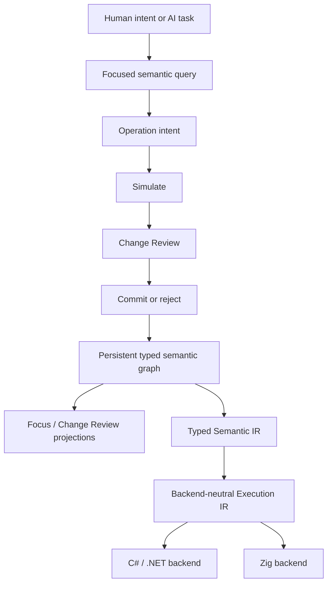

# Nyrwvy

> [!WARNING]
> **Under active development; not for use.** Formats, protocols and APIs change without notice or migration, and nothing here is supported. Please do not depend on it, and do not open issues or pull requests for now.

**Nyrwvy is an AI-native semantic programming system: programs are persistent typed semantic graphs, and changes are validated meaning-level operations.**

An AI agent does not edit source text. It calls a small set of tools — open a snapshot, inspect, create a type or function, replace one expression, review, commit — and every proposed change is validated and shown as a before/after review before it is published. Stable IDs keep each declaration's identity across edits and sessions. The committed graph compiles to C# (run on .NET) or to Zig.

This repository holds the F# core, the native Zig session host, the tool adapters (an MCP server and an OpenCode plugin), the specifications, the decision records and the verification evidence.

## Quick start

You need:

- Node 22.6+ (22.22.2 recommended, see [`.node-version`](.node-version)) and npm
- Zig 0.17.0 on `PATH`, or named by `NYRWVY_ZIG`
- .NET 10 SDK, feature band pinned in [`global.json`](global.json) (currently 10.0.4xx) — only for the C# backend and the F# tests

```shell
npm ci
npm run build:host        # builds tools/zig/host/bin/nyrwvy-host (a cold build takes a few minutes)
node --experimental-strip-types examples/function-abort/run.mjs
```

The example authors a function that reads a file through a capability and aborts on failure, using exactly the tool handlers an agent uses. It prints three scenario results and writes the snapshot and a transcript of every tool request to a temporary directory. Its [README](examples/function-abort/README.md) says what to look at; [`examples/`](examples/README.md) lists the other programs.

### Connect an AI agent

- **MCP:** run `npm --prefix tools/nyrwvy-mcp run setup`, then point your MCP client at `tools/nyrwvy-mcp/server.mjs`. See the [MCP guide](docs/specs/mcp-graph-tools.md).
- **OpenCode:** load the plugin under [`.opencode/`](.opencode/).

Both launch the native host. Rebuild it with `npm run build:host` after changing host sources; `NYRWVY_HOST_EXECUTABLE` selects another host binary ([decision](docs/decisions/zig-session-host.md)).

## How it works



The semantic graph is the source of truth. Generated C# or Zig, serialized files, reports and viewer pages are projections of it. The rules that follow from this:

- Stable IDs define identity; names are only presentation.
- Edits are typed semantic operations, never raw graph or file mutation.
- Every change is simulated and reviewed before it is published.
- An undecided part of a program is recorded as an explicit obligation, not left implicit.
- Generated backend code never flows back into the graph, and no backend defines the language's semantics.

## The agent tools

The tool handlers live in [`tools/nyrwvy-agent`](tools/nyrwvy-agent/); the MCP server ([`tools/nyrwvy-mcp`](tools/nyrwvy-mcp/README.md)) and the OpenCode tools expose the same handlers. The [tool contract](docs/specs/agent-graph-tools.md) documents all fourteen `nyrwvy_*` tools. The usual sequence:

| Step | Tool |
| --- | --- |
| Open or create a snapshot | `nyrwvy_open` |
| Read the relevant part of the graph | `nyrwvy_inspect` |
| Propose a change | `nyrwvy_create_type`, `nyrwvy_create_function`, `nyrwvy_replace` |
| Show a person the function or the pending review as HTML | `nyrwvy_view` |
| Publish or discard the proposal | `nyrwvy_commit`, `nyrwvy_reject` |
| Anything else in the protocol, by stable ID (including `runPure`) | `nyrwvy_request` |

`runPure` compiles the committed program and runs one function with fake capability responses. It runs in a child process limited to 5 s of wall time, a bounded output size and a heap of about 1 GiB (on both backends), with your user's permissions. **It is not a sandbox**, and the optional `hostSources` (off by default) compile and run arbitrary C#. See [SECURITY.md](SECURITY.md) and the [session protocol](docs/specs/agent-authoring-session.md).

Underneath, the Zig session host ([`tools/zig/host`](tools/zig/host/)) is a JSON-lines executable over a snapshot file. A workspace can pin other published snapshots as dependencies and upgrade them through a reviewed preview; see [pinned snapshot dependencies](docs/specs/agent-authoring-session.md#pinned-snapshot-dependencies).

The goal is an adequate AI graph-editing toolset — not a natural-language compiler, and not a human-written source language.

## Status

A research and implementation project by one maintainer. Each claim is bounded by its linked record; the evidence lives in the [verification records](docs/verification/README.md).

| Milestone | What it established |
| --- | --- |
| M0 | A graph is persisted, edited through review, and executed through generated code. |
| [M1](docs/plans/milestone-1.md) | Bounded typed operations: production stable IDs, fingerprints, reviewed publication, `Int64`, `Float64`, immutable `List<T>` and its pure higher-order operations. |
| [M2](docs/plans/milestone-2.md) | In a controlled evaluation, agents inspected, simulated, reviewed, published and recovered from stale proposals without unrelated semantic churn. |
| [Post-M2](docs/plans/post-m2-roadmap.md) | Agents create functions and type, effect and capability declarations, replace expressions, persist and reopen work, and migrate a parameter type with its callers — all with stable identities. |
| MCP | A Codex CLI live probe completed an identity-preserving maintenance task through review, commit and reopen ([scope](docs/specs/mcp-graph-tools.md#verification-and-scope)). |
| Language reach | Porting probes re-authored slices of a real Python application and several algorithmic programs, compared case by case; each gap became a recorded change ([index](docs/verification/README.md#live-agent-probes)). |

Linux is fully verified. Portability code also targets macOS and Windows, but their native runtime checks are on hold ([record](docs/decisions/zig-session-host.md), under "Current platform status").

## Build and test

Routine local checks (`./scripts/test-fast.fish` runs the first two):

```shell
dotnet test tests/Nyrwvy.Core.Tests/Nyrwvy.Core.Tests.fsproj --configuration Release --settings tests/fast.runsettings
node scripts/run-node-tests.mjs fast-contracts
npm run typecheck && npm test           # adapter, transport and MCP contracts
```

`npm test` needs the native host and the C# compiler helper built (the MCP setup above does both). The heavier suites run only when a change needs them:

| Command | Runs |
| --- | --- |
| `npm run test:node:extended` | Example pipelines that repeatedly generate and run C# |
| `fish scripts/test-extended.fish` | The xUnit extended suite and those pipelines |
| `npm run test:bun` | Bun unit tests for the OpenCode plugin (Bun 1.4.2) |
| `bash scripts/verify-local-20260825-1427.sh --clean` | A clean full-solution build and test with a shareable log |

The `CI` workflow runs the fast suite on every pull request and on pushes to `main`, and is a required check for `main`; the extended and native-platform suites run on demand. See the [verification philosophy](docs/developer/verification.md) for which checks a change needs, and [`tests/README.md`](tests/README.md#adapter-toolchain-and-typechecking) for the adapter toolchain.

## Repository layout

| Path | Contents |
| --- | --- |
| [`src/`](src/) | F# core: semantics, execution IR, C# and Zig backends, viewer |
| [`tools/`](tools/README.md) | Zig session host, Zig emitter, agent tool handlers, MCP server |
| [`.opencode/`](.opencode/) | OpenCode plugin and its tests |
| [`libraries/`](libraries/) | Shared libraries (`core`, `host`, `json`) |
| [`examples/`](examples/README.md) | Small programs authored through the tools |
| [`tests/`](tests/README.md), [`scripts/`](scripts/) | Test projects and test/build scripts |
| [`evaluation/`](evaluation/) | Probe programs and measurements |
| [`docs/`](docs/README.md) | Maintained documentation |
| [`docs-archive/`](docs-archive/README.md) | Historical material, not authoritative |

## Documentation

Start at the [documentation portal](docs/README.md). The most useful entry points:

- [Vision](docs/concepts/vision.md) — mission, principles and non-goals
- [Architecture](docs/developer/architecture.md) — boundaries and invariants
- [Current language subset](docs/reference/language-subset.md) — what the language and tools support now
- [Post-M2 roadmap](docs/plans/post-m2-roadmap.md) — completed work and what comes next
- [Decisions](docs/decisions/README.md) — why each direction was chosen
- [Developer guide](docs/developer/README.md) — implementation-oriented navigation

## Relationship to RAST

Nyrwvy is informed by earlier RAST work, but does not depend on it at runtime, semantically, or for design authority ([decision](docs/decisions/rast-provenance.md)).

## Security and license

See [SECURITY.md](SECURITY.md) for reporting a vulnerability and for what `runPure` and `hostSources` execute. Nyrwvy is licensed under the [Apache License, Version 2.0](LICENSE), including `evaluation/` and `docs-archive/`.
