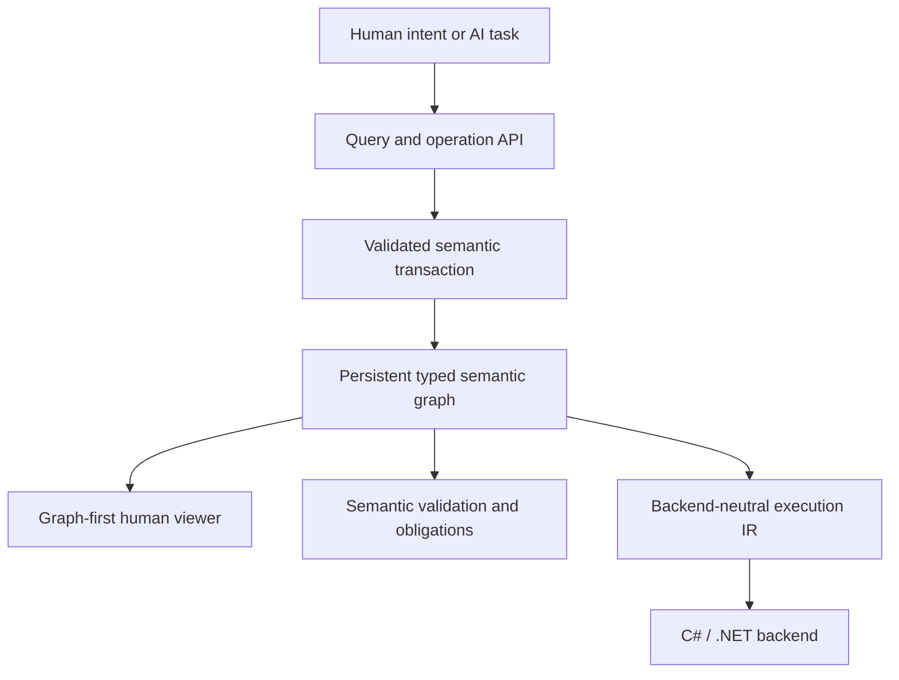

# Nayamnyam

**Nayamnyam is an AI-native semantic programming system in which programs are represented as persistent typed semantic graphs and changed through validated semantic operations.**

The project is designed around a simple reversal of the conventional programming model:

- source text is not the program's authoritative form;
- names and source positions are not semantic identity;
- AI agents request typed meaning-level changes instead of editing text patches;
- humans primarily understand, review, and approve programs through graph-oriented views;
- executable artifacts are generated through backend-neutral lowering, with C#/.NET as the first backend.

Nayamnyam is rebuilding Milestone 0 in F# from the last documentation-only baseline before the discarded C# semantic-core foundation. The accepted graph-first architecture remains authoritative; generated C# remains a downstream execution artifact.

## Core idea



The semantic graph is the source of truth. Textual code, generated C#, diagnostic reports, and visual diagrams are projections of that graph rather than competing program representations.

## Established direction

The following direction is accepted unless implementation evidence requires revision:

1. The persistent typed semantic graph is the authoritative program representation.
2. Program changes are expressed as semantic operations and applied transactionally.
3. Stable IDs define semantic identity; names are presentation metadata.
4. Explicit obligations represent unresolved work instead of guessed code.
5. The primary human interface is graph-first and review-oriented.
6. Human-authored source code is not a primary requirement.
7. Nayamnyam is an independent programming system, not an extension of a host language.
8. Lowering passes through backend-neutral IR before reaching C#/.NET.
9. The Milestone 0 semantic core is implemented in F#/.NET; generated C# remains the first execution backend.
10. The previous RAST project is a design reference and migration source, not a dependency.

## Rebuild status

The clean rebuild has verified the semantic foundation through Phase C:

- **Foundation:** F# solution, domain-typed stable IDs, immutable snapshot model, and CI.
- **Phase B:** strict canonical snapshot codec, snapshot validation, rename simulation, and semantic rename diff.
- **Phase C:** one authoritative function-owned node graph for direct calls, typed parameters, explicit `MissingArgument` obligations, `function.add_parameter`, obligation resolution, and semantic completeness.

The direct-call model deliberately has no parallel `Calls` collection: persistence, validation, semantic operations, queries, and future lowering must derive calls from the same graph nodes.

Lowering, C# generation, and the viewer have not been reintroduced yet. The next design gate is the value-node subset required by the Milestone 0 validation program and the Typed Semantic IR boundary above it.

See the rebuild records:

- [F# rebuild foundation](docs/rebuild-foundation-20260825.md)
- [Verified Phase B](docs/rebuild-phase-b-20260825.md)
- [Verified Phase C](docs/rebuild-phase-c-20260825.md)

## Initial milestone

Milestone 0 is a small end-to-end vertical slice based on user validation. The target remains:

```text
RawUserInput
    -> validate
Result<ValidUser, ValidationError>
    -> report through an explicit Console capability
```

See [Milestone 0](docs/milestone-0.md) for the complete acceptance criteria.

## Documentation

- [Vision](docs/vision.md) — purpose, priorities, non-goals, and success conditions
- [Architecture](docs/architecture.md) — system boundaries, data flow, invariants, and validation model
- [Decisions](docs/decisions.md) — accepted foundational decisions and their consequences
- [Open questions](docs/open-questions.md) — unresolved implementation and research questions
- [Milestone 0](docs/milestone-0.md) — first end-to-end validation slice

## Build and verification

The rebuild uses the .NET 10 SDK:

```shell
dotnet restore Nayamnyam.slnx
dotnet build Nayamnyam.slnx --configuration Release --no-restore
dotnet test Nayamnyam.slnx --configuration Release --no-build --no-restore
```

Phase C was verified through GitHub Actions with .NET SDK `10.0.400`: Release build completed with zero warnings and zero errors, and all 16 tests passed with zero skips.

## Relationship to RAST

Nayamnyam is informed by the earlier Readable AST Language work, including conservative semantic checking, explicit Result/Option handling, effect-oriented design, and backend-neutral IR experiments. RAST remains external to this repository; migrated rules or tests should record provenance rather than creating a runtime dependency.
