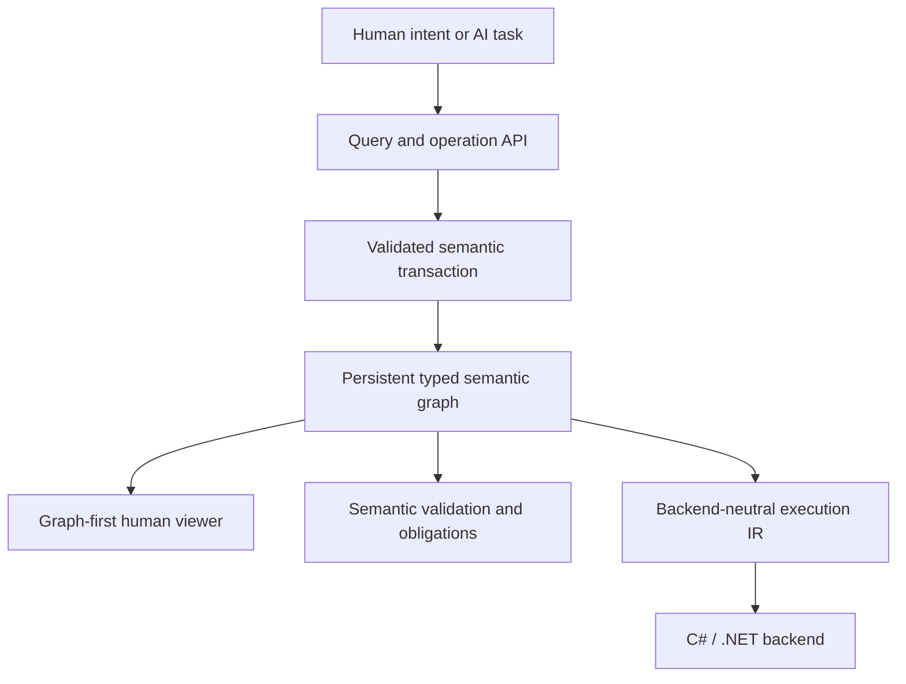

# Nayamnyam

**Nayamnyam is an AI-native semantic programming system in which programs are represented as persistent typed semantic graphs and changed through validated semantic operations.**

The project is designed around a simple reversal of the conventional programming model:

- source text is not the program's authoritative form;
- names and source positions are not semantic identity;
- AI agents request typed meaning-level changes instead of editing text patches;
- humans primarily understand, review, and approve programs through graph-oriented views;
- executable artifacts are generated through backend-neutral lowering, with C#/.NET as the first backend.

Nayamnyam is currently in its foundation implementation phase. The repository keeps direction-setting documents alongside the executable semantic core so implementation evidence can revise the design when necessary.

## Core idea



The semantic graph is the source of truth. Textual code, generated C#, diagnostic reports, and visual diagrams are projections of that graph rather than competing program representations.

## Established direction

The following direction is accepted unless implementation evidence requires revision:

1. The persistent typed semantic graph is the authoritative program representation.
2. Program changes are expressed as semantic operations and applied transactionally.
3. Stable IDs define semantic identity; names are presentation metadata.
4. Explicit obligations represent unresolved work instead of guessed code.
5. The primary human interface is graph-first and review-oriented.
6. Human-authored source code is not a primary requirement.
7. Nayamnyam is an independent programming system, not an extension of a host language.
8. Lowering passes through backend-neutral IR before reaching C#/.NET.
9. The previous RAST project is a design reference and migration source, not a dependency.

Implementation details such as graph serialization, ID generation, operation-log storage, graph layout, and future ownership semantics remain open research and design questions.

## Initial milestone

Milestone 0 is a small end-to-end vertical slice based on user validation:

```text
RawUserInput
    -> validate
Result<ValidUser, ValidationError>
    -> report through an explicit Console capability
```

It must demonstrate:

- persistent stable identity;
- product and union types;
- functions, direct calls, immutable bindings, branching, `Option`, and `Result`;
- one explicit effect and one typed external capability;
- validated semantic transactions;
- semantic diffs and explicit obligations;
- a read-only graph viewer for understanding and change review;
- deterministic lowering to C#, compilation, and execution on .NET.

See [Milestone 0](docs/milestone-0.md) for the complete acceptance criteria.

## Documentation

- [Vision](docs/vision.md) — purpose, priorities, non-goals, and success conditions
- [Architecture](docs/architecture.md) — system boundaries, data flow, invariants, and validation model
- [Decisions](docs/decisions.md) — accepted foundational decisions and their consequences
- [Graph Schema v2](docs/schema-v1.md) — Milestone 0 persistence and identity contract
- [Open questions](docs/open-questions.md) — unresolved implementation and research questions
- [Milestone 0](docs/milestone-0.md) — first end-to-end validation slice

## Build and verification

The supported verification path uses the .NET 10 SDK:

```shell
dotnet restore Nayamnyam.slnx
dotnet build Nayamnyam.slnx --configuration Release --no-restore
dotnet test Nayamnyam.slnx --configuration Release --no-build --no-restore
```

The CLI smoke path exercises the real executable boundary, persists a graph in the
specified store, generates C# source, and compiles and runs that generated program:

```shell
dotnet run --project src/Nayamnyam.Cli/Nayamnyam.Cli.csproj -- demo --store ./artifacts/demo
```

The same smoke path runs on every push and pull request through
[`.github/workflows/ci.yml`](.github/workflows/ci.yml).

## Relationship to RAST

Nayamnyam is informed by the earlier [Readable AST Language](https://github.com/kw4r3n/readable-ast-language), including its conservative semantic checking, explicit Result/Option handling, effect-oriented design, backend-neutral IR work, and Kotlin/C# backend experiments.

The reference snapshot used when establishing this repository is commit [`c5124f6777e9fc7eab014b9a72839571e98faa58`](https://github.com/kw4r3n/readable-ast-language/commit/c5124f6777e9fc7eab014b9a72839571e98faa58).

RAST remains external to this repository. Any rule, test, or implementation concept migrated from it should record provenance explicitly rather than creating a runtime or source dependency.

## Current status

- Direction: established
- Architecture: high-level boundaries accepted
- Detailed representation and storage formats: established for the Milestone 0 foundation
- Implementation: semantic core foundation in progress
- First execution backend: C#/.NET
- First human interface: read-only graph exploration and change review
