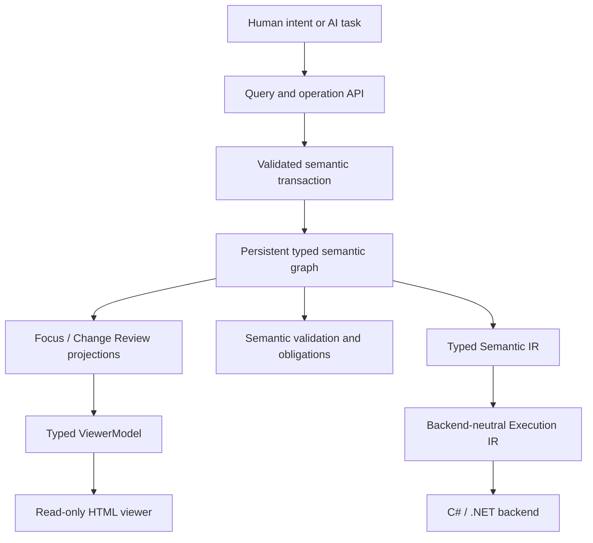

# Nayamnyam

**Nayamnyam is an AI-native semantic programming system in which programs are represented as persistent typed semantic graphs and changed through validated semantic operations.**

The project reverses several conventional programming assumptions:

- source text is not the program's authoritative form;
- names and source positions are not semantic identity;
- AI agents request typed meaning-level changes instead of editing text patches;
- humans primarily understand, review, and approve programs through graph-oriented views;
- executable artifacts are generated through backend-neutral lowering, with C#/.NET as the first backend.

Nayamnyam is rebuilding Milestone 0 in F# from the last documentation-only baseline before the discarded C# semantic-core foundation. The accepted graph-first architecture remains authoritative; generated C# remains a downstream execution artifact.

## Core idea



The semantic graph is the source of truth. Textual code, generated C#, diagnostic reports, serialized encodings, query payloads, viewer models, and visual artifacts are projections rather than competing program representations.

## Established direction

The following direction is accepted unless implementation evidence requires revision:

1. The persistent typed semantic graph is the authoritative program representation.
2. Program changes are expressed as semantic operations and applied transactionally.
3. Stable IDs define semantic identity; names are presentation metadata.
4. Explicit obligations represent unresolved work instead of guessed code.
5. The primary human interface is graph-first and review-oriented.
6. Human-authored source code is not a primary requirement.
7. Nayamnyam is an independent programming system, not an extension of a host language.
8. Lowering passes through backend-neutral IR before reaching C#/.NET.
9. The Milestone 0 semantic core is implemented in F#/.NET; generated C# remains the first execution backend.
10. The previous RAST project is a design reference and migration source, not a dependency.
11. When design choices conflict, AI semantic comprehension and edit reliability take priority over source-level elegance or brevity.

## Rebuild status

The clean rebuild has established the semantic foundation, representative Milestone 0 program, both IR stages, the first executable backend, read-only semantic query projections, and the first read-only human viewer:

- **Foundation:** F# solution, domain-typed stable IDs, immutable snapshot model, and CI.
- **Phase B:** strict reference snapshot codec, snapshot validation, rename simulation, and semantic rename diff.
- **Phase C:** one authoritative function-owned node graph for direct calls, typed parameters, explicit `MissingArgument` obligations, `function.add_parameter`, obligation resolution, and semantic completeness.
- **Phase D:** explicit `TypeRef`, product/union fields and variants with stable identity, primitive and Option/Result value nodes, nested lexical `ValueGraph` branches, exhaustive matching, pattern bindings, and graph-aware transactions.
- **Phase E:** explicit string predicates, stable effect/capability/operation identities, typed capability parameters, distinct `CapabilityInvoke` nodes, and explicit function effect requirements.
- **Phase F:** a representative `validate_user` / `report_validation` / `main` semantic graph using the complete Milestone 0 subset. No new semantic node kind was required.
- **Phase G / Nyason v0:** a strict Nayamnyam-specific encoding prototype with typed ID domains, closed tagged records, exact schema identity, canonical round-trip, and shape-constrained Option/Result forms.
- **Phase H / Typed Semantic IR:** one backend-neutral typed projection from validated, obligation-free snapshots; shared semantic type facts; stable provenance; normalized value nodes; explicit effect/capability contracts; canonical IR schema version 1.
- **Phase I / Execution IR:** deterministic execution-local value/block identities, explicit instruction order, explicit branch/match/return terminators, merge block parameters, explicit pattern extraction, rejection of unordered independent effects, and canonical serialization.
- **Phase J / C# backend:** deterministic C# generation from `ExecutionProgram` only, stable-ID-derived backend names, explicit capability-operation bindings, generated Console adapter, and compile/run proof of representative M0 behavior.
- **Phase K / semantic query projections:** focused function queries, caller/callee/dependency/use relationships, explicit unresolved declarations, open-obligation visibility, declaration closure, and Change Review projections derived from existing `SemanticDiff`.
- **Phase L / read-only viewer:** typed viewer models derived from Phase K projections, structured branch rendering, explicit stable identities and obligations, deterministic static HTML, and HTML-safe rendering without browser-side semantic state.

The direct-call model deliberately has no parallel `Calls` collection: persistence, validation, semantic operations, queries, and lowering derive calls from the same graph nodes. External capability invocation is a separate semantic node kind rather than a special internal call.

Type derivation is centralized: validator and Typed Semantic IR projection consume the same `SemanticFacts` node-type resolver rather than independently re-inferring meaning. Direct value dependency facts are likewise centralized for query consumers.

The AI-first design rule is explicit: local semantic clarity and mechanically detectable structure outrank concise source representation. See [AI-first semantic design principles](docs/ai-first-design-principles-20260825.md).

## Nyason status

JSON remains the strict reference/debug codec. [Nyason v0](docs/nyason-v0-20260825.md) is an experimental dedicated encoding, not yet the selected canonical persistence format.

On the representative Milestone 0 snapshot, the current pretty/self-describing Nyason v0 output is `16,205` UTF-8 bytes versus `8,440` bytes for compact JSON (`1.920x`). The mechanical safety properties are promising, but this cost is large enough that Q-001 remains open until AI comprehension/editing and focused-slice experiments are run.

See [Verified Nyason v0 experiment](docs/rebuild-phase-g-nyason-20260825.md).

## Next architecture gate

The next practical task is **viewer artifact/export tooling**.

The export layer should accept stable semantic IDs and Phase K/L projections, write deterministic Focus / Change Review artifacts outside the authoritative semantic model, and provide a small command/tool surface without turning HTML or filesystem layout into semantic state.

## Initial milestone

Milestone 0 is a small end-to-end vertical slice based on user validation:

```text
RawUserInput
    -> validate
Result<ValidUser, ValidationError>
    -> report through an explicit Console capability
```

See [Milestone 0](docs/milestone-0.md) for the complete acceptance criteria.

## Rebuild records

- [F# rebuild foundation](docs/rebuild-foundation-20260825.md)
- [Verified Phase B](docs/rebuild-phase-b-20260825.md)
- [Verified Phase C](docs/rebuild-phase-c-20260825.md)
- [Verified Phase D](docs/rebuild-phase-d-20260825.md)
- [Verified Phase E](docs/rebuild-phase-e-20260825.md)
- [Phase F representative semantic program](docs/rebuild-phase-f-20260825.md)
- [Verified Nyason v0 experiment](docs/rebuild-phase-g-nyason-20260825.md)
- [Verified Typed Semantic IR](docs/rebuild-phase-h-typed-semantic-ir-20260825.md)
- [Verified Execution IR](docs/rebuild-phase-i-execution-ir-20260825.md)
- [Verified C#/.NET backend](docs/rebuild-phase-j-csharp-backend-20260825.md)
- [Verified semantic query projections](docs/rebuild-phase-k-query-projections-20260825.md)
- [Verified read-only viewer](docs/rebuild-phase-l-read-only-viewer-20260825.md)

## Documentation

- [Vision](docs/vision.md) — purpose, priorities, non-goals, and success conditions
- [Architecture](docs/architecture.md) — system boundaries, data flow, invariants, and validation model
- [Decisions](docs/decisions.md) — accepted foundational decisions and their consequences
- [AI-first design principles](docs/ai-first-design-principles-20260825.md) — tie-breakers for semantic representation and agent reliability
- [Nyason v0 design constraints](docs/nyason-v0-20260825.md) — dedicated encoding candidate and evaluation gate
- [Open questions](docs/open-questions.md) — unresolved implementation and research questions
- [Milestone 0](docs/milestone-0.md) — first end-to-end validation slice

## Build and verification

The rebuild uses the .NET 10 SDK:

```shell
dotnet restore Nayamnyam.slnx
dotnet build Nayamnyam.slnx --configuration Release --no-restore
dotnet test Nayamnyam.slnx --configuration Release --no-build --no-restore
```

The latest clean local verification used .NET SDK `10.0.111`: Release build completed with zero warnings and zero errors, and all **79 tests passed** with zero skips. Focused verification also executed and passed all 6 Execution IR tests, 3 Execution IR codec tests, 4 C# backend tests, 7 semantic query tests, 3 Change Review query tests, and 6 read-only viewer tests.

GitHub Actions capacity was exhausted during the later rebuild phases, so timestamped clean local logs and TRX bundles are accepted as compiler/test evidence when the hosted runner cannot execute.

## Relationship to RAST

Nayamnyam is informed by the earlier Readable AST Language work, including conservative semantic checking, explicit Result/Option handling, effect-oriented design, and backend-neutral IR experiments. RAST remains external to this repository; migrated rules or tests should record provenance rather than creating a runtime dependency.
