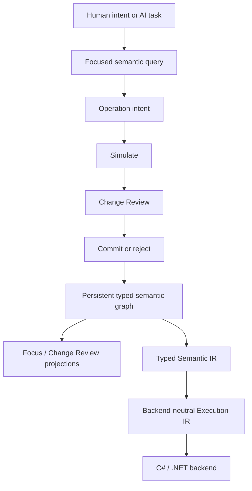

# Nyrwvy

> [!WARNING]
> **Under active development; not for use.** Formats, protocols and APIs change without notice or migration, and nothing here is supported. Please do not depend on it, and do not open issues or pull requests for now.

**Nyrwvy is an AI-native semantic programming system in which programs are persistent typed semantic graphs and changes are validated meaning-level operations.**

In plain terms: an AI agent writes and maintains a small, strongly typed program by calling a few tools (open a snapshot, inspect, create a type or function, replace one expression, review, commit) instead of editing source text. Every proposed change is validated and shown as a before/after review before it is published; stable IDs keep the program's identity across edits and sessions; and the committed graph is compiled to C# and run on .NET. The repository holds the F# implementation, the tool adapters (an MCP server and an OpenCode plugin), the specifications, the decision records and the verification evidence.

## Quick start

Prerequisites: a .NET 10 SDK (any patch of the feature band pinned in [`global.json`](global.json), currently 10.0.4xx), Node 22.6+ (22.22.2 recommended, see [`.node-version`](.node-version); older 22.x releases install the development dependencies with engine warnings), npm, and Zig 0.17.0 on `PATH` or selected with `NYRWVY_ZIG`. The native host build needs only Node and Zig; .NET remains required for the C# backend.

```shell
npm ci
npm run build:host
node --experimental-strip-types examples/function-abort/run.mjs
```

The example authors a function that reads a file through a capability and aborts on failure, using exactly the tool handlers an agent uses. It prints the three scenario results and writes a `workspace.json` snapshot and a `transcript.jsonl` of every tool request and review to a temporary directory. The [example README](examples/function-abort/README.md) explains what to look at; [`examples/`](examples/README.md) lists four more small programs kept as snapshots with generated runners, and the probe programs.

To drive the same tools from an AI agent, run the MCP server (`npm --prefix tools/nyrwvy-mcp run setup`, then point your MCP client at `tools/nyrwvy-mcp/server.mjs`) as the [MCP guide](docs/specs/mcp-graph-tools.md) describes; OpenCode users can load the plugin under `.opencode/` instead. The direct typed-read migration and Linux verification are complete, including focused, maintained, adapter, and benchmark checks. Portability code targets macOS and Windows too, but those native runtime checks are on hold: hosted platform jobs did not start under an account-level runner restriction, and the owner deferred another hosted attempt. This does not change product support scope. The F# session host was removed (its last commit is tag `fsharp-host-final`). See the [typed-read migration and platform verification record](docs/decisions/zig-session-host.md#step-8-blocker--typed-read-architecture-confirmed). The [tool contract](docs/specs/agent-graph-tools.md) lists the twelve `nyrwvy_*` tools.

The adapters launch the native Zig session host, `tools/zig/host/bin/nyrwvy-host`, which `npm run build:host` builds (a cold build takes a few minutes; rebuild it after changing host sources). `NYRWVY_HOST_EXECUTABLE` names any other host ([decision](docs/decisions/zig-session-host.md)). The .NET SDK is still required, since the C# backend (`runPure`, `emitCSharp`) builds with it.

## Core model

Source text is not the authoritative program form. Stable semantic identity, relationships, validation, change review, and unresolved work are represented explicitly so AI agents can make typed semantic changes without reconstructing program meaning from text, while humans can review what was requested and what will actually change.



The semantic graph is the source of truth. Textual code, generated C#, serialized encodings, diagnostic reports, query payloads, and viewer artifacts are projections or storage representations.

Important boundaries include:

- stable IDs define semantic identity; names are presentation metadata;
- ordinary edits use typed semantic operations rather than raw graph or serialization mutation;
- simulation and review precede publication;
- unresolved semantic decisions are represented explicitly as obligations when a safe incomplete state exists;
- generated backend source never becomes upstream authority;
- backend-specific representation choices do not define core language semantics.

## AI graph authoring

The host-neutral tool handlers live in `tools/nyrwvy-agent`; the stdio MCP server in `tools/nyrwvy-mcp` and the OpenCode tools in `.opencode/tools/nyrwvy.ts` expose the same handlers ([`tools/README.md`](tools/README.md) lists the maintained tools under `tools/` and where the removed evaluation runners can be replayed from). They let an AI open/create a snapshot, inspect scoped graphs, create types/functions, edit a chosen expression, review and commit/reject, then reopen the same identities. Start with `nyrwvy_open`, then use `nyrwvy_inspect`, `nyrwvy_create_type`, `nyrwvy_create_function` and `nyrwvy_replace`. `nyrwvy_view` writes a human-readable HTML page for a person to open: a function, or a pending proposal's Change Review before commit; the page is written beside the snapshot (under `nyrwvy-views/` by default) and never elsewhere. `nyrwvy_request` retains direct access to the complete maintained protocol, including exact stable-ID operations and `runPure`, which compiles the committed program and runs one function with fake capability responses. See the [tool contract and reference guide](docs/specs/agent-graph-tools.md).

`runPure` runs the compiled program in a child process bounded in wall time (5 s) and output size, with the permissions of the user who started the tool host. It is not a sandbox: its heap is bounded at 1 GiB on both backends, and its optional `hostSources` (off by default) compile and run arbitrary C#; see [SECURITY.md](SECURITY.md) and the [session protocol](docs/specs/agent-authoring-session.md).

Underneath, the Zig session host (`tools/zig/host`) is a JSON-lines executable over a snapshot file. An independent workspace can select one or several published snapshots with `create --snapshot <new-local-path> --dependency <source-snapshot-path>` (repeat `--dependency` for several); later use `open --snapshot <local-path>`. Sources with pinned dependencies are flattened into complete retained graphs. The read-only `dependency` operation shows the pinned provenance. Selected content is retained in a sidecar, while the local graph stores local declarations and references. Clone/move both files together. `nyrwvy_open` accepts `dependency` or `dependencies` on create and `mode: "pin"` for same-content recovery of older source-only selections. Review a version change with `previewDependencyUpgrade`, or `previewDependencyUpgrades` for a dependency set, then apply the reviewed selection with `mode: "upgrade"`; the set form supports both paired replacements and library consolidation/splitting while preserving local identities. See [pinned snapshot dependencies and recovery](docs/specs/agent-authoring-session.md#pinned-snapshot-dependencies). No per-program Python/F#/C# authoring helper is required.

The write-side goal is an adequate AI graph-editing toolset, not a natural-language compiler or a human-written source language. Human-facing projections can be graphical. [Structured-action research](docs/concepts/structured-agent-actions.md) distinguishes the relevant CODESTRUCT evidence from CGM and smaller AST-edit experiments.

## Status and evidence

Nyrwvy is an active research and implementation project by one maintainer. Each claim below is bounded by its linked record; build/test and evaluation evidence lives under [verification records](docs/verification/README.md), not on this page.

- **End-to-end lifecycle works** (Milestone 0): a graph is persisted, edited through review and executed through generated code.
- **Bounded typed operations are in place** (Milestone 1): production stable IDs, fingerprints, reviewed publication, physical assembly boundaries, `Int64`, immutable ordered `List<T>`, pure higher-order List operations, explicit IEEE 754 binary64 `Float64`, and controlled agent-evaluation evidence. See the [Milestone 1 record](docs/plans/milestone-1.md).
- **Agents can edit structure safely** (Milestone 2): a controlled evaluation showed that agents inspect, simulate, review, publish, and recover from stale structural proposals with system-owned identities and no unrelated semantic churn. See the [Milestone 2 record](docs/plans/milestone-2.md).
- **Declaration and expression authoring is maintained** (post-M2): agents create functions and Product/Union, Effect and Capability/Operation declarations, replace targeted expressions, persist and reopen work through the snapshot-backed AuthoringSession, reach an explicitly bound provider-backed execution path, and perform a bounded atomic parameter-type migration with required caller rewrites while preserving stable declaration identities. Production IDs remain system-owned. See the [post-M2 roadmap](docs/plans/post-m2-roadmap.md).
- **Ordinary AI graph tools and stdio MCP are maintained:** one Codex CLI live probe completed identity-preserving maintenance through review, commit and reopen, using local repository context alongside MCP tools. This does not establish tool-description-only discovery or compatibility with every host. See the [MCP guide and verification evidence](docs/specs/mcp-graph-tools.md#verification-and-scope).
- **The language covers small general-purpose programs:** a series of porting probes re-authored slices of a real Python application and a few algorithmic programs and compared them with their references case by case; each gap they found became a recorded language or tool change. The probe scripts are private; the [verification index](docs/verification/README.md#live-agent-probes) states what the records do and do not let a reader reproduce.

Completed controlled evaluations are reusable design evidence; they are not a requirement to repeat the same experiment for every adjacent semantic extension. The scoped-control-flow interaction boundary is tracked separately from the frozen M2 claim because it introduces lexical scope and nested branch graphs.

## Build and verify

Install a .NET 10 SDK of the feature band selected by [`global.json`](global.json) (currently 10.0.4xx; the pinned patch or any newer one is accepted through `rollForward: latestPatch`) and Node 22.6+ (22.22.2 recommended, see [`.node-version`](.node-version)); fish 3.4+ is needed only for the `.fish` wrapper scripts. Moving to another feature band or major version is an explicit repository change. Shared F# settings live in `Directory.Build.props`. Routine local development runs the fast test graph plus the ordinary-authoring and script contracts:

```shell
dotnet test tests/Nyrwvy.Core.Tests/Nyrwvy.Core.Tests.fsproj --configuration Release --settings tests/fast.runsettings
node scripts/run-node-tests.mjs fast-contracts
```

`./scripts/test-fast.fish` wraps the same two commands. The Node group includes ordinary authoring workflow, transport, and script contracts. Example pipelines that repeatedly generate and execute C# live under `.opencode/tests-extended/` and run only through the extended entry point.

The maintained Node/Bun adapters also have a repository-owned, locked TypeScript toolchain. From a clean checkout, no global `tsc`, OpenCode installation, or .NET build is needed to typecheck them:

```shell
npm ci
npm run typecheck
npm test
```

`npm test` is the fast root entry point for the adapter contracts plus the Node transport and MCP contracts (`test:adapters` and `test:node`; the latter needs the native host and standalone C# compiler helper built, available through the full MCP setup above). `npm run test:node:extended` selects only the heavy Node example pipelines; `fish scripts/test-extended.fish` runs both xUnit extended and those pipelines. These are deterministic checks, not live model evaluations. Node runs the Node adapters with native type stripping; Bun 1.4.2 runs only the Bun unit tests (`npm run test:bun`), which the CI workflow includes; the Node adapters do not need it. See [adapter setup and test suites](tests/README.md#adapter-toolchain-and-typechecking) for the dependency ownership, configuration boundaries, and runtime test prerequisites.

Tests run locally before a change is merged. The only GitHub Actions workflow, `CI` (the checks above plus the MCP and Bun contracts), is started manually by the maintainer at milestones rather than on every push or pull request, and the extended suite runs locally only; see the [verification philosophy](docs/developer/verification.md#reproducible-tooling-and-shell-checks). External pull requests are not accepted at this stage.

Use `./scripts/test-extended.fish` only when the changed boundary needs broader milestone/integration verification. For an opt-in clean full-solution build and test run with a shareable log:

```shell
bash scripts/verify-local-20260825-1427.sh --clean
```

The full-solution script includes the extended project once; it is not the routine fallback. Routine, milestone, and experimental verification have different roles; see the maintained [verification philosophy](docs/developer/verification.md) before promoting expensive checks into normal development.

## Documentation

Start with the [documentation portal](docs/README.md).

Useful entry points:

- [Vision](docs/concepts/vision.md) — mission, priorities, principles, non-goals, and success conditions.
- [Architecture](docs/developer/architecture.md) — current high-level boundaries and invariants.
- [Current language subset](docs/reference/language-subset.md) — implemented semantic and agent-editing surfaces at a glance.
- [Post-M2 roadmap](docs/plans/post-m2-roadmap.md) — completed M3-M5 outcomes and evidence-triggered conditions for later work.
- [Decisions](docs/decisions/README.md) — accepted rationale and bounded open questions.
- [Milestone 1 record](docs/plans/milestone-1.md) — completed bounded-operation milestone and the exact claim boundary.
- [Milestone 2 record](docs/plans/milestone-2.md) — completed bounded structural-editing milestone and controlled evaluation evidence.
- [Bounded structural editing spec](docs/specs/bounded-structural-editing.md) — historical Float64 body-replacement contract (implementation removed from `main`; see the evaluation freeze tags).
- [Expression structural authoring](docs/specs/expression-authoring.md) — maintained cross-domain recipe, scoped control flow, and calls/capability invocations within predeclared effects.
- [Contributor/reviewer entry point](docs/developer/README.md) — implementation-oriented navigation.

Historical and superseded material is kept separately under [`docs-archive/`](docs-archive/README.md) and is not authoritative for current behavior.

## Relationship to RAST

Nyrwvy is informed by earlier RAST work, but RAST is not a runtime, semantic, or design-authority dependency. Conceptual ancestry does not require a special provenance system; concrete copied or substantially adapted material uses ordinary source attribution. See the [RAST provenance decision](docs/decisions/rast-provenance.md).

## Security

See [SECURITY.md](SECURITY.md) for how to report a vulnerability and for the boundary of what `runPure` and `hostSources` execute.

## License

Nyrwvy is licensed under the [Apache License, Version 2.0](LICENSE). The probe material under `evaluation/` and the archived documentation under `docs-archive/` are covered by the same license.
