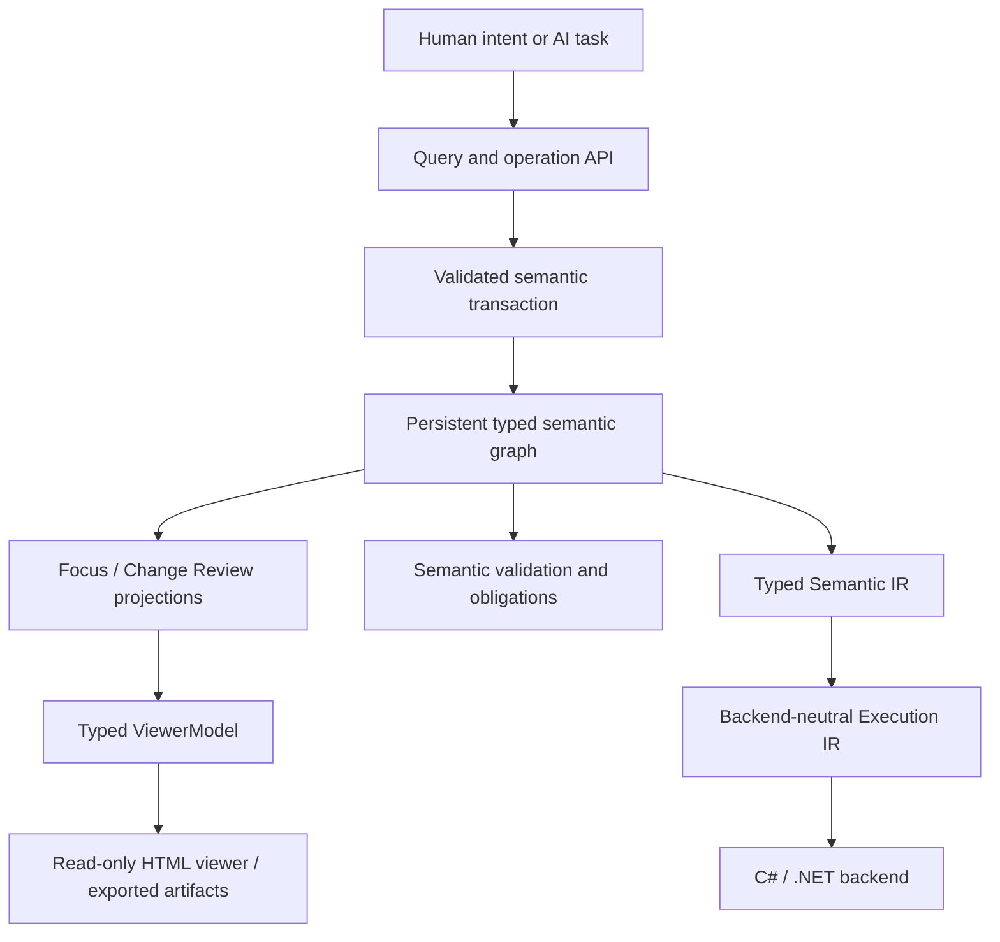

# Nayamnyam

**Nayamnyam is an AI-native semantic programming system in which programs are represented as persistent typed semantic graphs and changed through validated semantic operations.**

The project reverses several conventional programming assumptions:

- source text is not the program's authoritative form;
- names and source positions are not semantic identity;
- AI agents request typed meaning-level changes instead of editing text patches;
- humans primarily understand, review, and approve programs through graph-oriented views;
- executable artifacts are generated through backend-neutral lowering, with C#/.NET as the first backend.

Milestone 0 has now passed as an architectural proof. The accepted graph-first architecture remains authoritative; generated C#, viewer HTML, query payloads, and persistence encodings remain downstream artifacts rather than competing program representations.

## Core idea



The semantic graph is the source of truth. Textual code, generated C#, diagnostic reports, serialized encodings, query payloads, viewer models, and visual artifacts are projections.

## Established direction

The following direction is accepted unless implementation evidence requires revision:

1. The persistent typed semantic graph is the authoritative program representation.
2. Program changes are expressed as semantic operations and applied transactionally.
3. Stable IDs define semantic identity; names are presentation metadata.
4. Explicit obligations represent unresolved work instead of guessed code.
5. The primary human interface is graph-first and review-oriented.
6. Human-authored source code is not a primary requirement.
7. Nayamnyam is an independent programming system, not an extension of a host language.
8. Lowering passes through backend-neutral IR before reaching C#/.NET.
9. The semantic model is implemented in F#/.NET; generated C# remains the first execution backend.
10. The previous RAST project is a design reference and migration source, not a dependency.
11. When design choices conflict, AI semantic comprehension and edit reliability take priority over source-level elegance or brevity.

## Milestone 0 status

**Milestone 0 passes.** The complete vertical slice now proves construction, canonical persistence/reload, semantic validation, focused review, stable-ID-preserving edits, explicit incomplete state, transaction publication, two-stage lowering, deterministic C# generation, compilation, execution, and artifact reproducibility in one lifecycle.

The rebuild phases are:

- **Foundation:** F# solution, domain-typed stable IDs, immutable snapshot model, and verification infrastructure.
- **Phase B:** strict reference snapshot codec, validation, rename simulation, and semantic rename diff.
- **Phase C:** one authoritative function-owned graph, direct calls, typed parameters, explicit `MissingArgument` obligations, parameter addition, and obligation resolution.
- **Phase D:** explicit `TypeRef`, products/unions, Option/Result, nested lexical graphs, exhaustive matching, and pattern bindings.
- **Phase E:** string predicates, stable effect/capability identities, `CapabilityInvoke`, and explicit function effect requirements.
- **Phase F:** representative `validate_user` / `report_validation` / `main` semantic program.
- **Phase G / Nyason v0:** strict dedicated encoding experiment with typed ID domains and closed tagged shapes.
- **Phase H / Typed Semantic IR:** validated backend-neutral typed meaning with shared semantic facts and stable provenance.
- **Phase I / Execution IR:** explicit instruction order, control flow, pattern extraction, deterministic serialization, and conservative effect ordering.
- **Phase J / C# backend:** deterministic C# from `ExecutionProgram` only, explicit capability binding, and compile/run proof.
- **Phase K / semantic query projections:** Focus/Change Review data, callers/callees, dependencies/uses, declaration closure, and explicit missing declarations.
- **Phase L / read-only viewer:** typed viewer models, structured branches, stable identities, obligations, and safe deterministic HTML.
- **Phase M / viewer export:** deterministic Focus/Change Review artifacts and a strict stable-ID-only export CLI.
- **Phase N / transaction publication:** private immutable workspace state with explicit simulate / conservative commit / reject behavior and policy-gated incomplete publication.
- **Phase O / complete lifecycle:** one automated 15-step Milestone 0 scenario from persistence through review, edits, incomplete state, resolution, lowering, C# execution, and determinism.

See [Milestone 0 results](docs/milestone-0-results-20260826.md) for the final exit-criteria audit and architectural learnings.

## Important invariants established by Milestone 0

- Direct calls have no parallel authoritative `Calls` collection.
- External capability invocation is distinct from internal function calls.
- Validator and Typed Semantic IR use shared semantic type facts.
- Query consumers use shared direct dependency facts.
- Missing information becomes an explicit obligation, never a guessed default.
- Semantic readiness is distinct from backend executability.
- Canonical equality is defined by semantic identity and canonical bytes, not incidental in-memory list ordering.
- Viewer/export/backend layers never become upstream semantic authority.

## Nyason status

JSON remains the strict reference/debug codec. [Nyason v0](docs/nyason-v0-20260825.md) is an experimental dedicated encoding, not yet the selected canonical persistence format.

On the representative Milestone 0 snapshot, Nyason v0 is `16,205` UTF-8 bytes versus `8,440` bytes for compact JSON (`1.920x`). Its mechanical safety properties are promising, but Q-001 remains open until AI comprehension/editing experiments justify the size and ceremony cost.

## Next architecture gate

The next task is **Milestone 1 planning**, not another Milestone 0 feature phase.

The highest-value carry-over questions are:

- production stable-ID allocation (accepted direction: typed prefix + UUIDv7);
- canonical persistence choice and Nyason evaluation;
- whether backend/viewer/export should become separate .NET projects/assemblies;
- richer explicit operation-intent presentation in Change Review;
- viewer interaction/detail ergonomics without creating semantic state;
- which semantic constructs should be added next without sacrificing local AI interpretability.

Milestone 1 should extend the proven authority and dependency model selectively rather than replacing the Milestone 0 architecture wholesale.

## Rebuild records

- [F# rebuild foundation](docs/rebuild-foundation-20260825.md)
- [Verified Phase B](docs/rebuild-phase-b-20260825.md)
- [Verified Phase C](docs/rebuild-phase-c-20260825.md)
- [Verified Phase D](docs/rebuild-phase-d-20260825.md)
- [Verified Phase E](docs/rebuild-phase-e-20260825.md)
- [Phase F representative semantic program](docs/rebuild-phase-f-20260825.md)
- [Verified Nyason v0 experiment](docs/rebuild-phase-g-nyason-20260825.md)
- [Verified Typed Semantic IR](docs/rebuild-phase-h-typed-semantic-ir-20260825.md)
- [Verified Execution IR](docs/rebuild-phase-i-execution-ir-20260825.md)
- [Verified C#/.NET backend](docs/rebuild-phase-j-csharp-backend-20260825.md)
- [Verified semantic query projections](docs/rebuild-phase-k-query-projections-20260825.md)
- [Verified read-only viewer](docs/rebuild-phase-l-read-only-viewer-20260825.md)
- [Verified viewer artifact export](docs/rebuild-phase-m-viewer-export-20260826.md)
- [Verified transaction publication](docs/rebuild-phase-n-transaction-publication-20260826.md)
- [Verified complete M0 lifecycle](docs/rebuild-phase-o-m0-e2e-20260826.md)
- [Milestone 0 results / exit criteria](docs/milestone-0-results-20260826.md)

## Documentation

- [Vision](docs/vision.md) — purpose, priorities, non-goals, and success conditions
- [Architecture](docs/architecture.md) — system boundaries, data flow, invariants, and validation model
- [Decisions](docs/decisions.md) — accepted foundational decisions and consequences
- [AI-first design principles](docs/ai-first-design-principles-20260825.md) — semantic representation tie-breakers
- [Nyason v0 design constraints](docs/nyason-v0-20260825.md) — dedicated encoding candidate and evaluation gate
- [Open questions](docs/open-questions.md) — unresolved implementation/research questions
- [Milestone 0](docs/milestone-0.md) — original vertical-slice acceptance criteria

## Build and verification

The rebuild uses the .NET 10 SDK:

```shell
dotnet restore Nayamnyam.slnx
dotnet build Nayamnyam.slnx --configuration Release --no-restore
dotnet test Nayamnyam.slnx --configuration Release --no-build --no-restore
```

Latest accepted clean local verification:

```text
time:       2026-08-26T01:10:57+09:00
code head:  b74de0d660a39dc327a8c364c7ae937720cf0123
.NET SDK:   10.0.111
build:      0 warnings / 0 errors
full suite: 93 passed / 0 failed / 0 skipped
M0 E2E:      1 passed / 0 failed / 0 skipped
```

Focused TRX verification also passed all Execution IR, codec, C# backend, semantic query, Change Review, viewer, viewer artifact, workspace publication, and complete-lifecycle suites with `executed = total` and zero failure/not-executed counters.

GitHub Actions capacity was exhausted during later rebuild phases, so timestamped clean local logs and TRX bundles were used as compiler/test evidence when hosted runners could not execute.

## Relationship to RAST

Nayamnyam is informed by earlier Readable AST Language work, including conservative semantic checking, explicit Result/Option handling, effect-oriented design, and backend-neutral IR experiments. RAST remains external to this repository; migrated rules or tests should record provenance rather than creating a runtime dependency.
