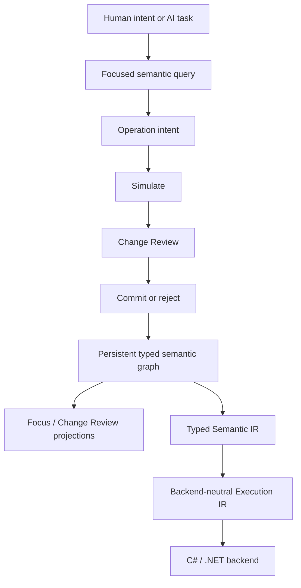

# Nyrwvy

**Nyrwvy is an AI-native semantic programming system in which programs are persistent typed semantic graphs and changes are validated meaning-level operations.**

Source text is not the authoritative program form. Stable semantic identity, relationships, validation, change review, and unresolved work are represented explicitly so AI agents can make typed semantic changes without reconstructing program meaning from text, while humans can review what was requested and what will actually change.

## Current status

Nyrwvy is an active research and implementation project.

- **Milestone 0 is complete:** the graph-first architecture has passed an end-to-end lifecycle from persistence through reviewed editing and generated execution.
- **Milestone 1 is complete for the accepted bounded-operation claim:** production stable IDs, fingerprints, reviewed publication, physical assembly boundaries, `Int64`, immutable ordered `List<T>`, pure higher-order List operations, explicit IEEE 754 binary64 `Float64`, and controlled agent-evaluation evidence are in place.
- **Milestone 2 is complete for the accepted structural-editing claim:** controlled evaluation established that agents can inspect, simulate, review, publish, and recover from stale structural proposals with system-owned identities and no unrelated semantic churn. The maintained Float64 body-replacement recipe now covers parameter references, exact literals, and the existing `Add` / `Subtract` / `Multiply` / `Divide` semantic operations; the specialized ListMap slice remains available as a separately typed operation.
- **Post-M2 M3-M5 authoring is now maintained:** agents can create functions, perform targeted expression replacement, persist/reopen work through the snapshot-backed AuthoringSession, create Product/Union, Effect, and Capability/Operation declarations, reach an explicitly bound provider-backed execution path, and perform the first bounded atomic parameter-type migration with required caller rewrites while preserving stable declaration identities. Production IDs remain system-owned; callers discover and reuse published identities rather than supplying them. See the [post-M2 roadmap](docs/plans/post-m2-roadmap.md) for the completed claim boundaries and the conditional next-stage policy.
- **Ordinary AI graph tools and stdio MCP are maintained:** one Codex CLI live probe completed known identity-preserving maintenance through review, commit and reopen, using local repository context alongside MCP tools. This does not establish tool-description-only discovery or compatibility with every host. See the [MCP guide and verification evidence](docs/specs/mcp-graph-tools.md#verification-and-scope).

Exact build/test and evaluation evidence belongs under verification records rather than this landing page. Completed controlled evaluations are reusable design evidence; they are not a requirement to repeat the same experiment for every adjacent semantic extension. The scoped-control-flow interaction boundary is tracked separately from the frozen M2 claim because it introduces lexical scope and nested branch graphs.

## Core model



The semantic graph is the source of truth. Textual code, generated C#, serialized encodings, diagnostic reports, query payloads, and viewer artifacts are projections or storage representations.

Important boundaries include:

- stable IDs define semantic identity; names are presentation metadata;
- ordinary edits use typed semantic operations rather than raw graph or serialization mutation;
- simulation and review precede publication;
- unresolved semantic decisions are represented explicitly as obligations when a safe incomplete state exists;
- generated backend source never becomes upstream authority;
- backend-specific representation choices do not define core language semantics.

## AI graph authoring

The ordinary OpenCode tools in `.opencode/tools/nyrwvy.ts` let an AI open/create a snapshot, inspect scoped graphs, create types/functions, edit a chosen expression, review and commit/reject, then reopen the same identities. For an independent workspace referencing a published snapshot, the JSON-lines executable also supports `create --snapshot <new-local-path> --dependency <source-snapshot-path>`; later use `open --snapshot <local-path>`. The read-only `dependency` operation shows the pinned provenance. Foreign declarations remain owned by the source and are not stored in the local snapshot. See [pinned snapshot dependency](docs/specs/agent-authoring-session.md#pinned-snapshot-dependency-one-level). No per-program Python/F#/C# authoring helper is required. Prepare the executable once:

```shell
dotnet build tools/Nyrwvy.AuthoringSession --configuration Release
```

Start with `nyrwvy_open`, then use `nyrwvy_inspect`, `nyrwvy_create_type`, `nyrwvy_create_function` and `nyrwvy_replace`. `nyrwvy_request` retains direct access to the complete maintained protocol, including exact stable-ID operations. See the [tool contract and reference guide](docs/specs/agent-graph-tools.md).

The write-side goal is an adequate AI graph-editing toolset, not a natural-language compiler or a human-written source language. Human-facing projections can be graphical. [Structured-action research](docs/concepts/structured-agent-actions.md) distinguishes the relevant CODESTRUCT evidence from CGM and smaller AST-edit experiments.

## Build and verify

The repository uses the .NET 10 SDK and Node 22 for the small tool and verification-script tests. Routine local development uses the fast test graph plus the ordinary-authoring and script contracts:

```shell
./scripts/test-fast.fish
```

Equivalent direct invocation:

```shell
dotnet test tests/Nyrwvy.Core.Tests/Nyrwvy.Core.Tests.fsproj --configuration Release --settings tests/fast.runsettings
node --experimental-strip-types --test .opencode/tests/nyrwvy-authoring-*.test.mjs scripts/tests/*.test.mjs
```

The maintained Node/Bun adapters also have a repository-owned, locked TypeScript toolchain. From a clean checkout, no global `tsc`, OpenCode installation, or .NET build is needed to typecheck them:

```shell
npm ci
npm run typecheck
npm run test:adapters
```

CI runs these checks plus the MCP, evaluation-transport, and Bun unit contracts. These are deterministic adapter checks, not live model evaluations. Node 22.6 or later runs the Node adapters with native type stripping; Bun 1.4.2 runs the Bun tests. See [adapter setup and test suites](tests/README.md#adapter-toolchain-and-typechecking) for the dependency ownership, configuration boundaries, and runtime test prerequisites.

Use `./scripts/test-extended.fish` only when the changed boundary needs broader milestone/integration verification.

For an opt-in clean full-solution build and test run with a shareable log:

```shell
bash scripts/verify-local-20260825-1427.sh --clean
```

The full-solution script includes the extended project once; it is not the routine CI fallback. Routine, milestone, and experimental verification have different roles; see the maintained [verification philosophy](docs/developer/verification.md) before promoting expensive checks into normal development or CI.

## Documentation

Start with the [documentation portal](docs/README.md).

Useful entry points:

- [Vision](docs/concepts/vision.md) — mission, priorities, principles, non-goals, and success conditions.
- [Architecture](docs/developer/architecture.md) — current high-level boundaries and invariants.
- [Current language subset](docs/reference/language-subset.md) — implemented semantic and agent-editing surfaces at a glance.
- [Post-M2 roadmap](docs/plans/post-m2-roadmap.md) — completed M3-M5 outcomes and evidence-triggered conditions for later work.
- [Decisions](docs/decisions/README.md) — accepted rationale and bounded open questions.
- [Milestone 1 record](docs/plans/milestone-1.md) — completed bounded-operation milestone and the exact claim boundary.
- [Milestone 2 record](docs/plans/milestone-2.md) — completed bounded structural-editing milestone and controlled evaluation evidence.
- [Bounded structural editing spec](docs/specs/bounded-structural-editing.md) — exact current Float64 body-replacement contract.
- [Expression structural authoring](docs/specs/expression-authoring.md) — maintained cross-domain recipe, scoped control flow, and calls/capability invocations within predeclared effects.
- [Contributor/reviewer entry point](docs/developer/README.md) — implementation-oriented navigation.

Historical and superseded material is kept separately under [`docs-archive/`](docs-archive/README.md) and is not authoritative for current behavior.

## Relationship to RAST

Nyrwvy is informed by earlier RAST work, but RAST is not a runtime, semantic, or design-authority dependency. Conceptual ancestry does not require a special provenance system; concrete copied or substantially adapted material uses ordinary source attribution. See the [RAST provenance decision](docs/decisions/rast-provenance.md).
