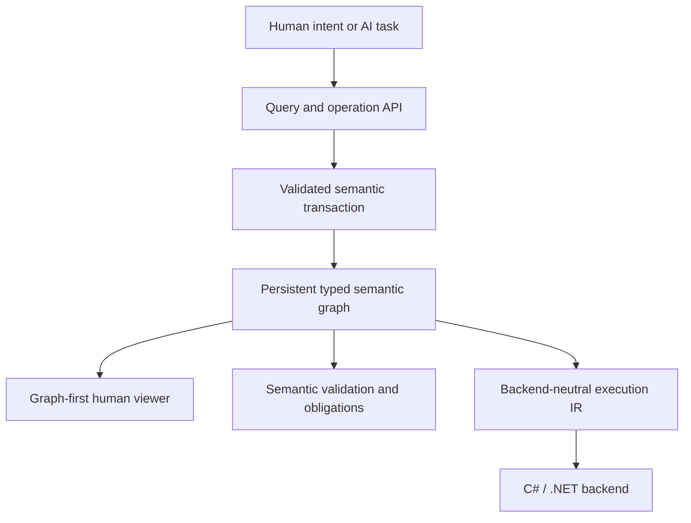

# Nayamnyam

**Nayamnyam is an AI-native semantic programming system in which programs are represented as persistent typed semantic graphs and changed through validated semantic operations.**

The project is designed around a simple reversal of the conventional programming model:

- source text is not the program's authoritative form;
- names and source positions are not semantic identity;
- AI agents request typed meaning-level changes instead of editing text patches;
- humans primarily understand, review, and approve programs through graph-oriented views;
- executable artifacts are generated through backend-neutral lowering, with C#/.NET as the first backend.

Nayamnyam is currently rebuilding the Milestone 0 semantic foundation in F# from the last documentation-only baseline before the discarded C# semantic-core experiment. The accepted graph-first architecture remains authoritative; generated C# remains a downstream execution artifact.

## Core idea



The semantic graph is the source of truth. Textual code, generated C#, diagnostic reports, and visual diagrams are projections of that graph rather than competing program representations.

## Established direction

The following direction is accepted unless implementation evidence requires revision:

1. The persistent typed semantic graph is the authoritative program representation.
2. Program changes are expressed as semantic operations and applied transactionally.
3. Stable IDs define semantic identity; names are presentation metadata.
4. Explicit obligations represent unresolved work instead of guessed code.
5. The primary human interface is graph-first and review-oriented.
6. Human-authored source code is not a primary requirement.
7. Nayamnyam is an independent programming system, not an extension of a host language.
8. Lowering passes through backend-neutral IR before reaching C#/.NET.
9. The Milestone 0 semantic core is implemented in F#/.NET; generated C# remains the first execution backend.
10. The previous RAST project is a design reference and migration source, not a dependency.

## Rebuild boundary

The current branch intentionally begins with a small semantic core: stable IDs, a minimal immutable snapshot envelope, CI, and invariant tests. Persistence, transactions, obligations, IRs, backend generation, and viewer projections are added only after their single authoritative representation and validation rules are explicit.

See [F# Milestone 0 rebuild foundation](docs/rebuild-foundation-20260825.md) for the staged rebuild rules.

## Initial milestone

Milestone 0 is a small end-to-end vertical slice based on user validation. The target remains:

```text
RawUserInput
    -> validate
Result<ValidUser, ValidationError>
    -> report through an explicit Console capability
```

See [Milestone 0](docs/milestone-0.md) for the complete acceptance criteria.

## Documentation

- [Vision](docs/vision.md) — purpose, priorities, non-goals, and success conditions
- [Architecture](docs/architecture.md) — system boundaries, data flow, invariants, and validation model
- [Decisions](docs/decisions.md) — accepted foundational decisions and their consequences
- [Open questions](docs/open-questions.md) — unresolved implementation and research questions
- [Milestone 0](docs/milestone-0.md) — first end-to-end validation slice
- [F# rebuild foundation](docs/rebuild-foundation-20260825.md) — restart invariants and implementation order

## Build and verification

The foundation uses the .NET 10 SDK:

```shell
dotnet restore Nayamnyam.slnx
dotnet build Nayamnyam.slnx --configuration Release --no-restore
dotnet test Nayamnyam.slnx --configuration Release --no-build --no-restore
```

CI runs the same build-and-test boundary on pushes and pull requests.

## Relationship to RAST

Nayamnyam is informed by the earlier Readable AST Language work, including conservative semantic checking, explicit Result/Option handling, effect-oriented design, and backend-neutral IR experiments. RAST remains external to this repository; migrated rules or tests should record provenance rather than creating a runtime dependency.
