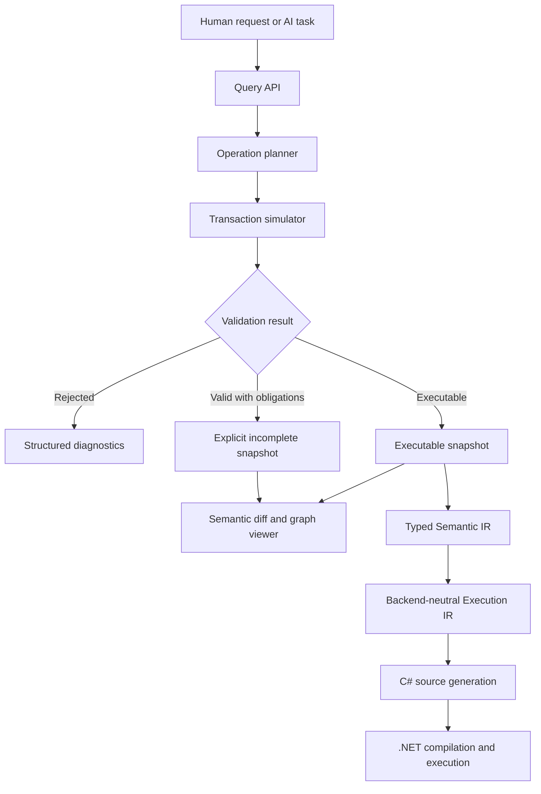

# Architecture

## Status

This document fixes NyamNyam's high-level boundaries and invariants while deliberately leaving storage formats, concrete ID encodings, graph database choices, layout algorithms, and detailed IR schemas open.

The architecture should be treated as stable direction, not as a frozen implementation design.

## System overview



The persistent typed semantic graph is the only authoritative program representation. All other forms are derived or proposed forms.

## Architectural layers

### 1. Query interface

The query interface exposes semantic facts without requiring consumers to traverse raw storage structures.

Initial query families should include:

- entity definition and metadata;
- references and reverse references;
- direct callers and callees;
- type and variant relationships;
- effect and capability dependencies;
- focused control-flow and data-flow slices;
- transaction impact;
- unresolved obligations;
- validation and execution readiness.

Queries must support bounded scopes such as relation kind, depth, ownership boundary, visibility, and change relevance. Repository-wide graph dumps are a diagnostic escape hatch, not the default agent interface.

### 2. Semantic operation layer

Operations express intended semantic transformations against stable targets.

An operation definition should include:

- operation kind and version;
- stable target IDs;
- typed arguments;
- preconditions;
- declared or computed read set;
- declared or computed write set;
- graph transformation;
- generated obligations;
- postconditions;
- semantic-diff contribution;
- optional inverse or compensation information;
- conflict and composition rules where known.

Operations are plans until a transaction commits them. Agents never receive direct mutable access to the authoritative graph.

### 3. Transaction engine

A transaction groups one or more operations and evaluates them against one explicit base revision.

The required flow is:

1. resolve targets against the base revision;
2. verify preconditions;
3. compute the proposed graph delta;
4. validate graph integrity;
5. derive semantic facts and obligations;
6. compute execution readiness;
7. generate a semantic diff and impact summary;
8. either reject or commit one new immutable snapshot.

A transaction never exposes a partially applied authoritative state.

#### Commit classes

NyamNyam distinguishes structural validity from executable completeness.

- **Rejected transaction** — violates graph integrity, references nonexistent entities without an explicit unresolved-reference construct, breaks ownership rules, uses an unsupported operation schema, or otherwise cannot form a valid snapshot. Nothing commits.
- **Valid incomplete transaction** — produces a structurally valid snapshot containing explicit blocking obligations. It may be committed only when the transaction policy permits obligations. Backend lowering is forbidden.
- **Executable transaction** — produces a structurally valid snapshot with no blocking obligations and passes the required semantic checks. It may proceed to lowering.

This distinction allows meaningful large changes to be recorded without accepting malformed state or guessed behavior.

### 4. Persistent typed semantic graph

The graph stores program identity and meaning-level relationships.

Expected entity categories include:

- workspace, package, and module boundaries;
- types, type parameters, fields, and variants;
- functions, parameters, and external capabilities;
- local bindings and value-producing nodes where stable identity is useful;
- control-flow and data-flow structures;
- effects and capability requirements;
- obligations;
- provenance and revision metadata.

Expected edge categories include:

- ownership;
- references;
- calls;
- argument-to-parameter association;
- type membership and type use;
- field access and construction;
- variant construction and matching;
- control transfer;
- data dependency;
- effect requirement and capability provision;
- obligation impact.

The authoritative model is graph-shaped even where a particular substructure has tree ownership.

## Identity model

Semantic identity is represented by opaque stable IDs.

At minimum, distinct ID domains are expected for:

- modules;
- types;
- fields;
- variants;
- functions;
- parameters;
- local bindings;
- graph nodes;
- effects;
- capabilities;
- obligations;
- snapshots and transactions.

Names, display paths, source anchors, graph positions, and serialized order are not identity.

A stable ID must survive operations such as:

- rename;
- movement between display groups when semantically legal;
- parameter reordering;
- projection regeneration;
- unrelated graph changes.

The exact encoding, generation strategy, copy semantics, and cross-repository identity policy remain open.

## Derived facts and indexes

Not every useful relation must be stored directly.

The architecture distinguishes:

- **authoritative facts** — entity identity, declared types, operation-created structure, declared effects, explicit obligations;
- **derived facts** — inferred types, reverse-reference indexes, call graph indexes, control-flow reachability, effect closure, impact summaries;
- **projections** — viewer data, generated textual forms, reports, and backend artifacts.

Derived facts may be cached, but caches must be reproducible from an authoritative snapshot and invalidated by revision.

## Validation model

Validation is separated into explicit stages so that failure causes remain inspectable.

### Graph integrity validation

Checks structural rules such as:

- unique IDs within their domains;
- valid ownership and containment;
- valid edge endpoints;
- argument edges targeting parameters of the selected callee;
- no forbidden ownership cycles;
- operation-schema conformance;
- obligation references pointing to existing affected entities.

Integrity failures reject the transaction.

### Semantic validation

Checks or derives:

- type compatibility;
- binding and reference legality;
- function signature compatibility;
- control-flow result completeness;
- union match exhaustiveness;
- effect requirements and capability availability;
- external boundary contracts;
- supported feature constraints.

Semantic validation may either reject the transaction or produce explicit obligations, depending on whether a safe incomplete representation exists.

### Execution-readiness validation

Checks that:

- no blocking obligations remain;
- all required symbols and types are resolved;
- all used features belong to the active lowering subset;
- the selected backend profile can represent the program;
- external capabilities have backend bindings.

Only execution-ready snapshots may lower to executable IR.

## Obligations

An obligation is a typed first-class entity representing work that must be resolved before a defined stage can proceed.

An obligation should carry:

- stable obligation ID;
- obligation kind and version;
- affected entity IDs;
- reason and originating transaction;
- required decision or missing semantic fact;
- candidate repairs when they can be derived safely;
- severity and blocking stage;
- status and resolution provenance.

Example obligation kinds include:

- missing argument for a newly added parameter;
- missing match arm after adding a union variant;
- unspecified backend binding for an external capability;
- unresolved policy choice where multiple type-correct behaviors exist.

Obligations are not comments and are not compiler errors stored as strings. They participate in queries, impact views, transactions, and semantic diffs.

## Semantic diff

A semantic diff describes changes in program meaning and structure rather than only serialized lines.

It should distinguish at least:

- created, removed, renamed, and moved entities;
- signature changes;
- control-flow and data-flow changes;
- effect changes;
- automatically propagated updates;
- newly generated, resolved, and remaining obligations;
- public-boundary changes;
- execution-readiness changes;
- affected tests or validation scenarios when known.

Textual or serialized diffs may remain available for storage diagnostics, but they are not the primary review artifact.

## Human viewer

The viewer is a query client and projection layer over the graph. It does not own program state.

The initial viewer is read-only and supports understanding and review rather than visual programming.

### Initial view families

- **Focus view** — one selected function or type with immediate inputs, outputs, calls, data dependencies, effects, and related obligations.
- **Flow view** — control and data flow inside a selected function at an appropriate level of abstraction.
- **Change review view** — transaction summary, affected graph slice, semantic diff, validation result, and obligations.
- **Obligation view** — unresolved work grouped by cause and affected semantic area.

### Viewer constraints

- display focused slices rather than the whole repository;
- preserve stable spatial placement where practical;
- choose layout based on relation semantics rather than one universal force layout;
- support progressive disclosure;
- distinguish edges by label and shape, not color alone;
- keep detailed local expressions available in structured text when a graph would be less readable;
- never imply that display position is semantic identity.

## Lowering pipeline

NyamNyam uses two conceptual IR boundaries.

### Typed Semantic IR

This projection preserves validated language meaning while removing editing-only concerns such as operation history and viewer layout.

It may retain:

- resolved stable references;
- complete types;
- effects;
- product and union structure;
- structured control flow;
- source graph provenance for diagnostics.

### Backend-neutral Execution IR

This representation prepares explicit execution behavior without adopting a particular target language's syntax or object model.

It should make decisions such as:

- evaluation order;
- branching and matching;
- value construction;
- error propagation;
- capability invocation;
- runtime representation requirements.

Backend-specific representation choices belong after this boundary.

## C#/.NET backend

C#/.NET is the first backend because it provides a managed runtime, generics, practical interop, cross-platform execution, and a path to future Native AOT experiments without forcing ownership semantics into the initial core.

For Milestone 0, the backend must:

- consume Execution IR only;
- generate deterministic C# source;
- generate required minimal runtime support;
- bind one typed Console capability;
- compile with the selected .NET SDK;
- execute the user-validation example;
- map diagnostics back to semantic entity IDs where practical.

C# source is a build artifact. It is not an authoritative input and is not intended for manual modification.

Native AOT, reflection policy, optimized value layouts, and advanced interop are outside Milestone 0.

## External capabilities

External behavior enters the graph through typed capability contracts rather than arbitrary embedded host-language code.

A capability contract is expected to define:

- stable capability identity;
- operation signatures;
- input and output types;
- declared effects;
- explicit failure model;
- determinism and concurrency properties when relevant;
- backend binding metadata.

The first capability is Console output. Filesystem, network, time, randomness, databases, and process execution are deferred.

## Determinism and reproducibility

Given the same:

- authoritative snapshot;
- operation schemas;
- validator version;
- lowering profile;
- backend version and configuration;

NyamNyam should produce the same semantic diff, execution IR, and generated source apart from explicitly declared nondeterministic metadata.

Canonical serialization is required for storage and testing even though humans are not expected to edit it directly.

## Isolation boundaries

The implementation should preserve the following dependency direction:

```text
storage adapters
    -> semantic graph model
        -> validation and operation engine
            -> query and projection APIs
                -> viewer
        -> semantic lowering
            -> execution IR
                -> C# backend
```

The semantic core must not depend on the viewer, C# syntax, or the legacy RAST implementation.

The C# emitter must not parse user-facing input or repeat name and type resolution already completed by the semantic pipeline.

## Failure reporting

Failures should be structured and machine-readable. A diagnostic should identify:

- category and stable code;
- stage;
- severity;
- affected entity IDs;
- originating transaction or operation when applicable;
- human explanation;
- available repair actions;
- whether the failure rejected the transaction, created an obligation, or blocked lowering.

Plain exception text is insufficient as the public contract between components.
