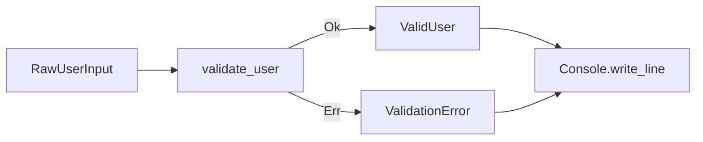

# Milestone 0 — Semantic Vertical Slice

## Purpose

Milestone 0 validates the central NyamNyam claim with one small executable program:

> A persistent typed semantic graph can serve as the authoritative program representation, support safe meaning-level change, present useful graph-oriented review information to a human, and deterministically lower to an existing execution platform.

This is not a general-purpose language release. It is an architectural proof with explicit exit criteria.

## Demonstration domain

The representative program validates user input and reports the result through a typed Console capability.



A concrete model may use the following semantic entities:

```text
RawUserInput
- name: String
- email: String
- display_name: Option<String>

ValidUser
- name: String
- email: String
- display_name: Option<String>

ValidationError
- EmptyName
- InvalidEmail

validate_user(input: RawUserInput) -> Result<ValidUser, ValidationError>
report_validation(result: Result<ValidUser, ValidationError>, console: Console) -> Unit
```

The exact validation algorithm is intentionally simple. The milestone evaluates semantic representation and change behavior, not email-validation sophistication.

## Required semantic subset

### Primitive values

- `String`
- `Bool`
- `Unit`

### Type forms

- product types with named fields;
- union types with named variants;
- generic `Option<T>`;
- generic `Result<T, E>`.

### Program forms

- functions with stable identities;
- parameters with stable identities;
- direct function calls;
- argument-to-parameter relationships by parameter identity;
- immutable local bindings;
- field access;
- product construction;
- union and Result/Option construction;
- conditional branching or exhaustive union matching;
- explicit function result;
- ordinary Result propagation or an equivalent structured graph form.

### Effect and external boundary

- one declared Console output effect;
- one typed external Console capability;
- one synchronous `write_line(String) -> Unit` operation;
- one C#/.NET binding implemented outside the semantic core.

Async operations, implicit global I/O, and arbitrary embedded C# are forbidden in this milestone.

## Required graph behavior

### Authoritative construction

The example program must be constructible through a semantic builder or operation API without parsing a human-authored source file.

A JSON fixture may be used for tests only if it is interpreted as canonical graph data or operation input, not as a hidden text-language parser.

### Stable identity

At minimum, stable IDs are required for:

- types;
- fields;
- variants;
- functions;
- parameters;
- effects;
- capabilities;
- obligations;
- transactions and snapshots.

The `validate_user` function must retain the same identity after a rename. All callers must continue to reference that identity without reference search or textual replacement.

### Snapshot model

- every committed program state has a snapshot ID or revision;
- transactions name one base snapshot;
- successful commit creates one new snapshot;
- stale-base transactions are rejected;
- rejected transactions do not modify the current snapshot;
- canonical snapshot serialization is deterministic.

## Required operation slice

Milestone 0 must implement at least the following semantic operations.

### `symbol.rename`

Renames the display name of a function or type while preserving stable identity and all existing references.

Required demonstration:

```text
validate_user -> validate_profile
```

The resulting C# program must preserve behavior, while the semantic diff reports one rename rather than a delete-and-create pair.

### `function.add_parameter`

Adds a parameter with a new stable parameter ID and updates the function signature.

The operation must use an explicit call-site strategy:

1. provide a value rule that resolves every affected call; or
2. generate a blocking `MissingArgument` obligation for each unresolved call.

It must never silently insert an arbitrary value.

Required demonstration:

```text
validate_profile(
    input: RawUserInput,
    policy: ValidationPolicy
)
```

At least one existing call initially lacks a policy value. The proposed snapshot remains structurally valid through an explicit obligation and is not execution-ready until the obligation is resolved.

### Obligation resolution

A follow-up operation must resolve the missing argument by attaching a valid graph value to the affected parameter edge. The obligation becomes resolved with transaction provenance, and execution readiness is restored.

## Transaction requirements

The operation API must expose three distinct actions:

- **simulate** — compute the proposed snapshot, validation result, obligations, impact, and semantic diff without publishing it;
- **commit** — publish the exact simulated or equivalently revalidated transaction against the same base snapshot;
- **reject** — leave the authoritative snapshot unchanged.

A transaction result must distinguish:

- rejected due to graph-integrity or operation failure;
- valid but incomplete with blocking obligations;
- executable.

Milestone 0 may permit incomplete commits only through an explicit `allow_blocking_obligations` policy. The default should be conservative.

## Validation requirements

### Graph integrity

The validator must reject at least:

- duplicate stable IDs;
- references to nonexistent entities outside an explicit unresolved construct;
- invalid ownership edges;
- an argument targeting a parameter not owned by the selected callee;
- an operation applied to the wrong entity kind;
- a transaction whose base revision is stale.

### Semantic validation

The validator must detect at least:

- argument type mismatch;
- missing required argument;
- invalid function return type;
- field access on the wrong type;
- non-exhaustive `ValidationError` handling;
- missing Console effect requirement;
- missing backend binding for the Console capability.

Where a safe incomplete representation exists, the failure may become a typed obligation. Otherwise, the transaction is rejected.

### Execution readiness

Lowering is allowed only when:

- no blocking obligations remain;
- all referenced entities resolve;
- all used types and operations belong to the Milestone 0 subset;
- every effect requirement is satisfied;
- the Console capability has an active C# binding.

## Semantic diff requirements

The diff model must report meaning-level changes with stable IDs.

For the required operation sequence, it must show:

- `validate_user` renamed to `validate_profile` while preserving function ID;
- one `ValidationPolicy` type or equivalent value definition created if needed;
- one parameter added with its stable ID;
- affected call sites;
- generated `MissingArgument` obligations;
- obligation resolution and the value attached to each call;
- execution-readiness transition from executable to incomplete and back to executable;
- no unrelated entity churn.

A serialized line diff may be emitted for diagnostics, but it does not satisfy this requirement.

## Viewer requirements

The initial viewer is read-only. It is a projection and query client, not the owner of program state.

### Focus View

When `validate_user` or `validate_profile` is selected, the viewer must show:

- input and output types;
- direct callers and callees in the demonstration graph;
- the validation branch structure at a useful abstraction level;
- `Result` success and failure paths;
- the Console effect path where applicable;
- related blocking obligations;
- stable IDs in an inspectable detail panel, without requiring them in every label.

### Change Review View

For a simulated transaction, the viewer must show:

- base and proposed snapshot identities;
- operation summary;
- focused affected graph slice;
- semantic diff;
- validation status;
- automatically propagated changes;
- blocking obligations and their causes;
- whether the proposed state can be lowered and executed.

### Layout and accessibility

- no full-repository force-directed hairball is acceptable as the primary view;
- relation labels or distinguishable edge forms are required;
- meaning must not depend on color alone;
- small unrelated changes should not completely rearrange the focused view;
- local expressions may use structured text inside or beside graph nodes.

The milestone does not require visual editing, drag-to-connect programming, or a production-quality UI framework.

## Lowering and backend requirements

The executable path is:

```text
Persistent semantic graph
    -> Typed Semantic IR
    -> Backend-neutral Execution IR
    -> deterministic C# source
    -> .NET compilation
    -> execution
```

The C# emitter must consume Execution IR only. It must not:

- parse graph storage directly;
- repeat name resolution;
- repeat type inference already completed by validation;
- treat generated source as an upstream editable input.

### Required generated behavior

For representative valid and invalid inputs, the executable must:

- produce a `ValidUser` result for valid input;
- produce `ValidationError.EmptyName` for an empty name;
- produce `ValidationError.InvalidEmail` for the selected invalid-email rule;
- render the result through the typed Console capability;
- preserve observable behavior across the rename operation;
- refuse lowering while the added-parameter obligation is open;
- compile and run after the obligation is resolved.

### Determinism

Given identical graph snapshot, toolchain version, and backend profile:

- Typed Semantic IR is byte-for-byte canonical after serialization;
- Execution IR is byte-for-byte canonical after serialization;
- generated C# source is byte-for-byte deterministic;
- semantic diff ordering is deterministic;
- diagnostic and obligation ordering is deterministic.

Machine-specific build paths and compiler-produced binary metadata are not required to be byte-for-byte identical.

## Required end-to-end scenario

The milestone is complete only when one automated or reproducible scenario performs all of the following:

1. construct the initial graph without a source-language parser;
2. persist and reload the graph without identity loss;
3. validate it as execution-ready;
4. render the Focus View data for `validate_user`;
5. lower, generate C#, compile, and execute representative inputs;
6. simulate and commit `symbol.rename`;
7. confirm stable function identity and unchanged observable behavior;
8. simulate `function.add_parameter` without supplying every call-site value;
9. show the affected graph slice, semantic diff, and blocking obligation;
10. optionally commit the incomplete snapshot only under explicit policy;
11. confirm lowering is blocked;
12. resolve the obligation through a semantic operation;
13. confirm execution readiness is restored;
14. generate, compile, and execute the updated program;
15. reproduce canonical graph and generated-source outputs in a clean run.

## Testing requirements

### Unit tests

- stable-ID value behavior;
- entity ownership rules;
- operation preconditions;
- rename identity preservation;
- parameter-to-argument association;
- transaction atomicity;
- stale-base rejection;
- obligation creation and resolution;
- deterministic serialization;
- validator rule isolation;
- semantic-diff classification.

### Property or invariant tests

Where practical:

- rename never changes target identity;
- rejected transactions preserve the exact base snapshot;
- canonical serialize/deserialize preserves graph equivalence and identity;
- unresolved blocking obligations always prevent lowering;
- resolving all blocking obligations does not alone guarantee readiness unless all validators pass;
- generated references always target declared stable IDs before IR lowering.

### Integration tests

- full user-validation graph to C# execution;
- Console capability binding;
- semantic transaction preview and commit equivalence;
- viewer query payloads for focus and change review;
- clean-environment reproducibility.

## Deliverables

Milestone 0 should produce:

- versioned semantic graph schema for the accepted subset;
- canonical snapshot serializer and loader;
- stable-ID model;
- query API slice;
- semantic operation schemas and transaction engine slice;
- validators and structured diagnostics;
- obligation model;
- semantic diff model;
- read-only graph viewer prototype;
- Typed Semantic IR and Execution IR schemas;
- deterministic C# emitter and minimal runtime adapter;
- automated end-to-end demonstration;
- tests and a short results report identifying which architectural assumptions held or failed.

## Explicitly out of scope

- human-authored surface language;
- RAST source importing;
- multiple packages or remote dependencies;
- trait or interface dispatch;
- generic user-defined functions beyond builtin `Option` and `Result` needs;
- mutable shared state;
- ownership and borrowing;
- async and cancellation;
- filesystem, network, clock, randomness, database, or process capabilities;
- exception interoperability beyond the chosen Console adapter boundary;
- Kotlin, Rust, Wasm, LLVM, or direct IL backends;
- Native AOT;
- optimization beyond straightforward deterministic lowering;
- semantic merge between concurrent branches;
- visual program construction;
- production authentication or approval policy.

## Exit criteria

Milestone 0 passes only if all of the following are demonstrated with evidence:

1. **Graph authority:** the program is created, persisted, modified, and executed without an authoritative source-code input.
2. **Identity continuity:** rename and signature evolution preserve the intended stable entities.
3. **Atomic change:** invalid transactions leave the base snapshot unchanged.
4. **Explicit incompleteness:** unresolved signature impact becomes visible obligations rather than guessed values or malformed graph state.
5. **Human observability:** the viewer makes structure, effect flow, change impact, and obligations understandable without requiring generated C# review.
6. **Executable semantics:** an obligation-free validated graph lowers through both IR stages and runs on .NET.
7. **Determinism:** canonical artifacts reproduce in a clean run.
8. **Architectural isolation:** the semantic core has no dependency on the viewer, generated C#, or the previous RAST implementation.
9. **Structured failure:** rejection, incompleteness, and backend blocking are distinguishable through machine-readable results.
10. **Documented learning:** deviations from the accepted architecture and unresolved risks are recorded before Milestone 1 planning.
