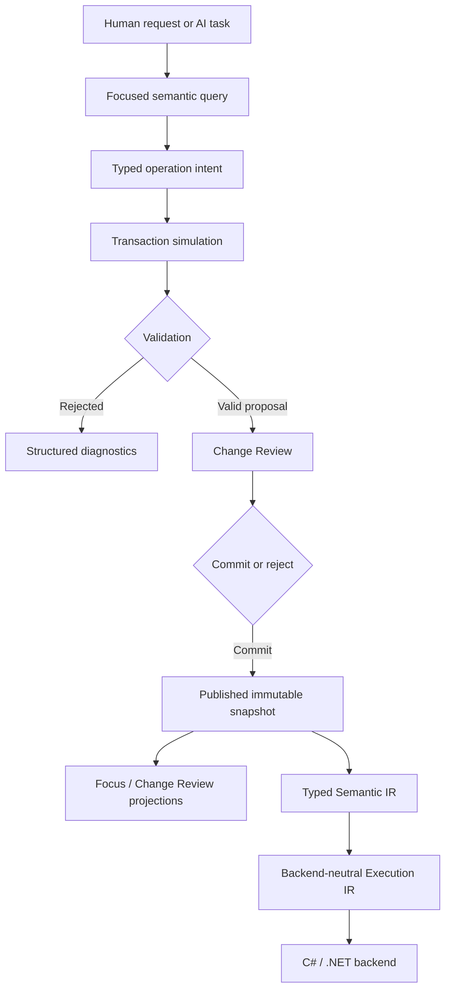

# Architecture

**Status:** Current

This document defines Nyrwvy's maintained high-level boundaries and invariants. Concrete storage media, broader graph layouts, cross-repository merge semantics, and other explicitly open areas may evolve without changing these boundaries.

## Core invariants

1. The persistent typed semantic graph is the authoritative program representation.
2. Ordinary program changes are typed semantic operations against stable targets, not raw storage or source patches.
3. Stable IDs carry semantic identity; names, serialized positions, paths, and viewer coordinates do not.
4. Publication is atomic at the immutable snapshot boundary.
5. Safe unresolved semantic work is represented explicitly as obligations rather than guessed behavior.
6. Requested operation intent and resulting semantic diff are distinct review facts.
7. Typed Semantic IR and backend-neutral Execution IR separate program semantics from backend representation.
8. Generated code, viewer artifacts, indexes, storage encodings, and evaluation artifacts never become competing semantic authority.
9. Full validation remains the normative correctness oracle; incremental validation may optimize it but cannot redefine it.
10. Persistent storage remains replaceable while the permanent medium is unresolved.

These invariants intentionally do not require one dedicated operation or protocol per semantic role. The breadth of an agent-facing typed operation surface may evolve while these invariants remain intact.

## System flow



Simulation and reviewed commit use the same ordered operation request. A reviewed proposal is bound to the exact request, base, and proposed result; stale or substituted proposals require a new review.

### Low-level reviewed receipts

`SemanticWorkspace.simulate` returns an opaque in-process `TransactionPreviewReceipt` that retains the immutable `TransactionRequest`, including the ordered operation list and all operation payloads. `commitReviewed` and `commitReviewedWithPolicy` require structural equality with that retained request, not object identity or merely an equal final snapshot. Inserting, removing, replacing, or reordering operations requires a fresh review even when the proposed fingerprints are unchanged. This binding uses the existing typed request directly; it introduces no request hash, stable-ID allocation, or durable operation encoding.

Existing diagnostic precedence is preserved: request IDs, already-published snapshot identity, simulation (including `StaleBaseSnapshot`), base fingerprint, and result fingerprints are checked before the additional ordered-intent comparison. A different ordered request with otherwise matching facts rejects with `PreviewReceiptRequestMismatch`. Existing `PreviewReceiptBaseMismatch`, `PreviewReceiptResultMismatch`, and blocking-obligation policy remain intact.

The receipt continues to expose these read-only facts:

- `TransactionId`;
- `BaseSnapshotId` and `BaseSnapshotFingerprint`;
- `ProposedSnapshotId`, `ProposedSnapshotFingerprint`, and `ProposedSemanticFingerprint`.

**In-process API migration:** receipt record construction, record copying, and record-pattern matching are no longer public operations. Low-level callers retain the receipt returned by simulation and pass it unchanged to reviewed commit; property reads and commit function signatures remain the same. Receipts for distinct requests may now compare unequal despite identical exposed facts. This is an intentional source/API restriction, not a claim of binary compatibility or cryptographic approval.

Ordinary `AgentWorkflow` proposals already retain the request and continue through this same reviewed-commit path. Structural and declaration workflows retain their intent and exact materialized snapshot in their own opaque proposals; their snapshot-only receipts do not authorize a low-level `TransactionRequest`.

Wire receipt objects remain the existing six-field read-only projections. They are not deserializable publication authority. AuthoringSession and frozen evaluation protocols retain their existing proposal handles and encodings; no snapshot schema, fingerprint domain, stable identity, or historical evaluation record changes.

## Implementation boundaries

The maintained production dependency direction is approximately:

```text
Nyrwvy.Semantics
      ^        ^
      |        |
Execution    Viewer
      ^        ^
      |        |
Backend.CSharp  Tools
```

Evaluation protocols and controlled harnesses are downstream of these production boundaries:

```text
semantic / execution / backend contracts
              ↓
       tools and adapters
              ↓
   evaluation protocols/harnesses
              ↓
     recorded evidence
```

### `Nyrwvy.Semantics`

Owns stable IDs and allocation, semantic graph state, validation/readiness, semantic facts and queries, operations and transactions, obligations, fingerprints, reviewed proposals, and the ordinary agent workflow facade.

### `Nyrwvy.Execution`

Owns Typed Semantic IR, backend-neutral Execution IR, and trusted projection from committed agent workspaces into executable representations.

### `Nyrwvy.Backend.CSharp`

Consumes Execution IR plus an explicit backend profile and emits deterministic C#. It does not query or mutate authoritative semantic snapshots directly.

### `Nyrwvy.Viewer`

Consumes semantic query/review projections and renders human-facing Focus and Change Review artifacts. Viewer state is not semantic state.

### `Nyrwvy.Tools.*`

Compose public APIs and own filesystem, process, CLI, export, adapter, and other operational integration.

## Evaluation boundary

Evaluation is evidence about Nyrwvy, not upstream authority over Nyrwvy.

A controlled evaluation may reveal that an interaction model is confusing, unreliable, or too permissive and thereby justify a production design change. The dependency does not reverse: frozen corpus wording, proposal-handle bookkeeping, OpenCode transport details, orchestration metrics, or historical protocol quirks do not constrain the semantic core merely because they were recorded in an experiment.

When historical replay requires preserving such behavior, keep compatibility in the evaluation or adapter layer. If a protocol is deliberately promoted from evaluation machinery to a maintained product contract, record that as a separate design decision rather than inheriting the status implicitly from a frozen run.

Evidence produced by an expensive experiment remains useful while its assumptions hold. See [Verification philosophy](verification.md) for the distinction between regression validation, milestone validation, and experimental evidence generation.

## Semantic state and operations

The published snapshot is authoritative current program state. Transaction or operation history may be retained for provenance, audit, metrics, or migration assistance, but it is not a second source of truth.

Operations are explicit and ordered. The engine may later recognize commuting operations, merge proposals, or rebase work, but it must not silently reorder or rewrite a reviewed operation sequence under the current contract.

Ordinary agent creation APIs allocate new production identities on the system side. Import or migration workflows that need to preserve external identities are privileged, distinct operations.

## Validation, obligations, and readiness

Nyrwvy distinguishes at least four classes of failure/state:

- invalid proposed semantic state -> transaction rejection / validation diagnostic;
- valid but genuinely unresolved semantic state -> typed obligation when a safe incomplete form exists;
- valid semantic program unsupported by a selected backend/profile -> lowering or backend-readiness diagnostic;
- expected runtime-domain failure -> explicit program semantics such as `Result` or `Option`.

See the [failure and obligation policy](../specs/failure-obligation-policy.md) for the maintained classification rules.

### Request-scoped derived facts

`SnapshotComputationScope` can reuse validation, canonical serialization and
fingerprints for the exact same immutable snapshot object during a synchronous
request/pass. AuthoringSession and its JSONL adapter establish this scope;
nested calls share it and disposal clears retained snapshots. It is not a global
snapshot-ID cache. Different snapshot objects still undergo full validation,
including commit re-simulation results and semantic-fingerprint normalization.
No-scope callers use the uncached oracle. External-file/dependency checks and
publication I/O are never memoized. Optional measurement/reuse-disable controls
support the [authoring profiling probe](../../scripts/measure-authoring-passes.fsx),
not a semantic-validation bypass.

## Identity

Production stable IDs are typed semantic identities. Their current payload and textual contract are documented in the [stable-ID reference](../reference/stable-ids.md).

Rename, semantically legal movement, Git clone, and Git branch preserve semantic identity. Duplication or template instantiation of genuinely new semantic objects allocates new IDs. General cross-repository import, identity collision, and semantic merge policy remain open.

## Lowering and backends

Executable snapshots project through two explicit boundaries:

```text
semantic graph
  -> Typed Semantic IR
  -> backend-neutral Execution IR
  -> backend implementation
```

Typed Semantic IR preserves validated language meaning without editing-only authority. Execution IR makes operational behavior such as evaluation order and control transfer explicit before target-specific emission.

C#/.NET is the first backend. Its representation choices are downstream implementation details and may not redefine numeric, collection, effect, failure, or identity semantics. See the [C# backend specification](../specs/csharp-backend.md).

## Persistence and schema evolution

Storage representation is deliberately separate from semantic authority.

- strict JSON remains the reference/debug baseline;
- Nyason is the actively explored Nyrwvy-native portable encoding candidate;
- a database may serve as a working/index store and could become authoritative only if operational evidence justifies that choice without changing semantic meaning;
- schema versions are explicit and migrations must not silently invent semantics.

The current snapshot-backed session guarantees atomic publication and persistence across authoring-process restarts on a healthy OS/filesystem. It does not claim machine-crash or power-loss durability; see the [persistence guarantee and failure boundaries](../specs/agent-authoring-session.md#persistence-guarantee-and-failure-boundaries).

See [Nyason and storage direction](../concepts/nyason-and-storage.md) and the [schema evolution policy](../specs/schema-evolution-policy.md).

## Human review and projections

The viewer is a query/projection client rather than a mutable source editor. The established view contracts include focused semantic slices and Change Review.

Change Review preserves both:

1. **requested intent** — what operation the editing client asked for; and
2. **resulting semantic diff** — what the engine says will actually change.

Automatic propagation, generated obligations, and readiness changes may make those facts differ meaningfully.

## Deliberately open areas

The high-level architecture does not currently fix:

- permanent authoritative persistence medium;
- general cross-repository import and semantic merge/rebase policy;
- the eventual breadth and composition model of agent structural-authoring operations;
- broader workspace graph layout and visualization contracts;
- ownership/borrowing semantics for future backend needs;
- cryptographic or organization-specific approval policy;
- speculative capability metadata for consumers that do not yet exist.

These uncertainties are tracked in [Open questions](../decisions/open-questions.md) and must not be filled silently by implementation convenience or historical evaluation precedent.
